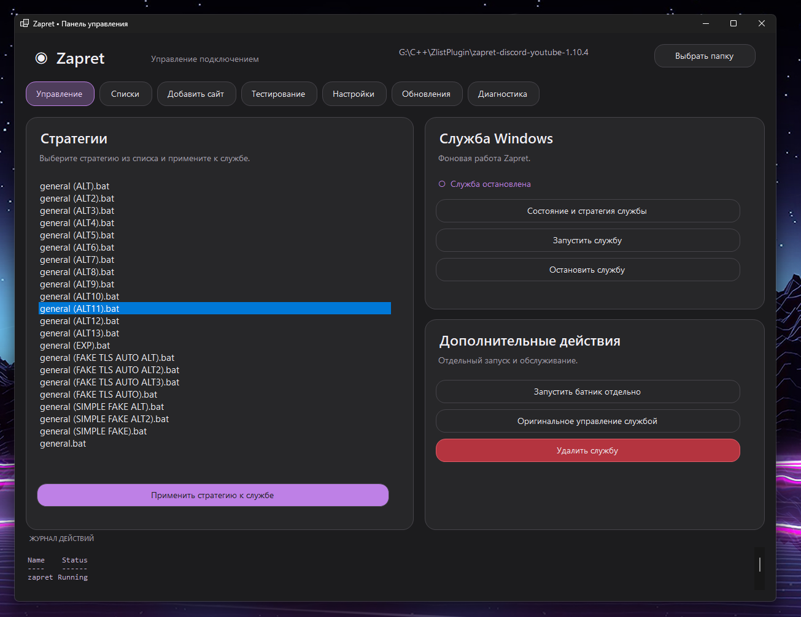

# gui-for-zapret-fs

**Версия 0.2.2 · Windows x64 · C# / .NET 8**

Портативный графический интерфейс для [Flowseal Zapret](https://github.com/Flowseal/zapret-discord-youtube) на Windows. Независимая оболочка: сам Zapret разрабатывается в исходном проекте и скачивается отдельно.



## Возможности

- Запуск выбранной стратегии и установка, запуск, остановка и удаление службы Windows.
- Порядок стратегий как в оригинальном меню: ALT, ALT2…ALT13, затем остальные группы.
- Редактор доменных и IP-списков с автосохранением, проверкой записей и защитой от перезаписи внешних изменений.
- Добавление сайтов вручную, из истории Chrome, Edge, Opera и Firefox либо из вкладок Chromium через CDP.
- Проверка стратегий HTTP/TLS/ping и DPI TCP 16–20 с отменой и восстановлением исходного состояния.
- Диагностика системы, Game Filter, IPSet и отдельный выбор fake-файлов Discord UDP и Game Filter UDP.
- Обновление Flowseal Zapret с сохранением пользовательских списков и переключением выбранной папки.
- Тёмный интерфейс и заголовок окна. Подтверждение требуется только при удалении службы.

## Скачать

[Скачать портативный ZIP для Windows x64](https://github.com/AnsansImm/gui-for-zapret-fs/releases/latest/download/gui-for-zapret-fs-win-x64-portable.zip) · [Все версии](https://github.com/AnsansImm/gui-for-zapret-fs/releases)

Начиная с 0.2.0 релиз распространяется архивом. Внутри — `gui-for-zapret-fs.exe`, встроенная среда .NET и папка `scripts`. Установка программы и отдельная установка .NET не требуются.

## Запуск

1. Скачайте портативный ZIP и распакуйте **всю папку** в доступное для записи место.
2. Скачайте и распакуйте [Flowseal Zapret](https://github.com/Flowseal/zapret-discord-youtube/releases/latest), если его ещё нет.
3. Запустите `gui-for-zapret-fs.exe` и выберите папку вида `zapret-discord-youtube-x.x.x`.
4. Выберите стратегию и примените её к службе либо запустите батник отдельно на вкладке «Управление».

Не переносите EXE отдельно от папки `scripts`: сценарии нужны для диагностики, тестов и обновлений. Настройки находятся в `config.json` рядом с программой, отчёты — в `runtime`. Для системных действий Windows запросит права администратора.

Сам Zapret, драйвер WinDivert и стратегии в архив GUI не включены. После переноса папки Zapret выберите её заново и повторно примените стратегию к службе.

## Добавление сайтов

На вкладке «Добавить сайт» введите домен или полную HTTP/HTTPS-ссылку либо выберите сайт из истории браузера. Затем нажмите «Через Zapret» или «Исключить из Zapret». Домен переносится между пользовательскими списками без дубликатов.

CDP подключается только к `127.0.0.1`, порт по умолчанию — `9222`. Chromium нужно запустить с `--remote-debugging-port=9222` и отдельным `--user-data-dir`. Firefox использует историю. История показывает последние посещения, а не обязательно текущую вкладку; данные читаются локально. Файл истории можно выбрать вручную.

Для применения изменений списков перезапустите Zapret.

## Редактор списков

- Изменения сохраняются через 0,8 секунды после ввода или кнопкой «Сохранить».
- HTTP/HTTPS-ссылки преобразуются в домены. Начальный `www.` и повторяющиеся домены удаляются, международные имена преобразуются в Punycode.
- В файлах `ipset*.txt` проверяются IPv4/IPv6, длина префикса подсети и порядок границ диапазона. Сокращённые IPv4 и адреса с ведущими нулями отклоняются.
- Поддерживаются отдельные строки-комментарии и комментарии после адреса: `example.org # комментарий`. При сохранении такой комментарий переносится на отдельную строку перед записью. Фрагмент URL `#section` комментарием не считается.
- Ошибка показывает номер строки и отменяет сохранение всего файла. Если файл изменила другая программа, редактор не перезаписывает его.

## Сборка

Нужны Windows и SDK .NET 8. Версия SDK задаётся в `global.json`; дополнительные компоненты Rust, MSVC и Cargo не нужны.

```powershell
dotnet build gui-for-zapret-fs.csproj -c Release
dotnet run --project gui-for-zapret-fs.csproj
```

Готовая обычная сборка: `bin/Release/net8.0-windows/gui-for-zapret-fs.exe`. Для неё нужен установленный .NET 8 Desktop Runtime. Ограничение не относится к портативному релизному архиву.

Портативный релиз с .NET 8.0.31 внутри:

```powershell
powershell -NoProfile -ExecutionPolicy Bypass -File scripts/build-release.ps1
```

Сценарий создаёт `dist/0.2.2/gui-for-zapret-fs-win-x64-portable.zip` и файл SHA256. При первой автономной сборке необходим доступ к NuGet.
Если все пакеты уже загружены, можно собрать из локального кеша: `powershell -NoProfile -ExecutionPolicy Bypass -File scripts/build-release.ps1 -Offline`.

## Проверки

```powershell
dotnet run --project tests/Verification/Verification.csproj -c Release
powershell -NoProfile -ExecutionPolicy Bypass -File tests/Verify-Scripts.ps1
powershell -NoProfile -ExecutionPolicy Bypass -File tests/Verify-Service.ps1
```

Проверки используют временные списки и локальный архив обновления; они не изменяют реальные списки и службы Zapret. Интеграционная проверка реального драйвера, браузеров и сетевых стратегий выполняется отдельно.

## Релизы и переход с Rust

Версия 0.1.0 была написана на Rust. В 0.2.0 интерфейс перенесён на C# / Windows Forms. История проекта и предыдущий релиз могут сохраняться в том же репозитории.

Для обновления GUI распакуйте новый архив в отдельную папку и выберите существующую папку Zapret. Пользовательские списки остаются в папке Zapret. При необходимости перенесите `config.json` из предыдущей папки GUI.

GitHub Actions проверяет проект при push/PR. При публикации тега `v0.2.2` сценарий релиза собирает портативный ZIP и загружает его вместе с SHA256 в GitHub Releases.

Совместимость вручную проверялась пользователем со сборкой Flowseal 1.10.4. Локальные настройки, отчёты, папка Zapret и результаты сборки не включаются в репозиторий.
