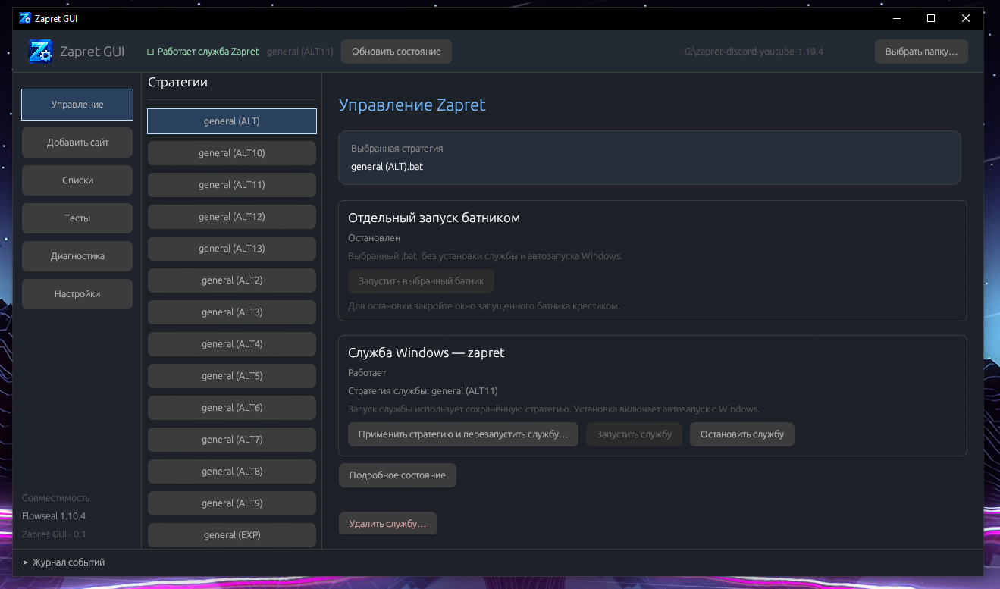

# GUI-for-zapret-FS

Портативный графический интерфейс для [Flowseal Zapret](https://github.com/Flowseal/zapret-discord-youtube) на Windows. Независимая оболочка: сам Zapret разрабатывается в исходном проекте и скачивается отдельно.



## Возможности (Дублирование CLI настройки через GUI)

- Запуск выбранного батника и отдельное управление службой Windows с отображением их состояния.
- Редактор доменных и IP-списков с автосохранением. Для доменов — удаление повторов и начального `www.`.
- Быстрое добавление сайтов из Chrome, Firefox, Opera и Edge: вкладки через CDP для Chromium, история посещений — запасной вариант. Добавление в обход или исключения.
- Проверка стратегий HTTP/TLS/ping и DPI TCP 16–20 с восстановлением исходного состояния после теста.
- Диагностика, настройка Game Filter/IPSet и выбор fake-файлов.
- Обновление Flowseal Zapret с GitHub с переносом пользовательских списков. Предыдущая папка сохраняется; служба и путь в настройках переключаются на новую версию.

## Скачать

[Скачать GUI-for-zapret-FS.exe](https://github.com/AnsansImm/GUI-for-zapret-FS/releases/latest/download/GUI-for-zapret-FS.exe) · [Все версии](https://github.com/AnsansImm/GUI-for-zapret-FS/releases)

## Запуск

1. Скачайте и распакуйте [Flowseal Zapret](https://github.com/Flowseal/zapret-discord-youtube/releases/latest).
2. Запустите `GUI-for-zapret-FS.exe` и выберите папку вида `zapret-discord-youtube-x.x.x`.
3. Выберите стратегию и запустите батник либо установите службу на вкладке «Управление».

Установка GUI не требуется. Настройки находятся в `config.json` рядом с программой, отчёты тестов — в `runtime`. Для системных действий Windows запросит права администратора. После переноса папки Zapret выберите её заново и повторно примените стратегию службы.

## Добавление сайтов

Откройте «Добавить сайт», выберите браузер и нажмите «Найти сайты». Проверьте домен и выберите «Через Zapret» или «Исключить из Zapret». Для применения изменений перезапустите работающий Zapret.

**Ручное добавление:** просто скопируйте ссылку целиком из адресной строки браузера и вставьте её в поле «Домен или адрес сайта». Программа сама извлечёт домен и уберёт начальный `www.`. Затем нажмите «Через Zapret» или «Исключить из Zapret».

CDP подключается только к `127.0.0.1` (по умолчанию порт `9222`) и требует запуска Chromium-браузера с `--remote-debugging-port=9222`. Chrome 136+ также требует отдельную папку профиля через `--user-data-dir`. Firefox использует историю. История показывает последние посещения, а не обязательно текущую вкладку; данные читаются локально. Для нестандартного профиля можно выбрать файл истории вручную.

## Сборка

Нужны Rust stable, инструменты C++ MSVC и Windows SDK. При первой сборке загрузите зависимости:

```powershell
cargo fetch
powershell -ExecutionPolicy Bypass -File scripts/build-release.ps1
```

Готовый файл: `target/release/GUI-for-zapret-FS.exe`.

```powershell
cargo test --offline
```

Совместимость проверялась со сборкой Flowseal 1.10.4. Локальные настройки, папка Zapret и результаты сборки не включаются в репозиторий.
